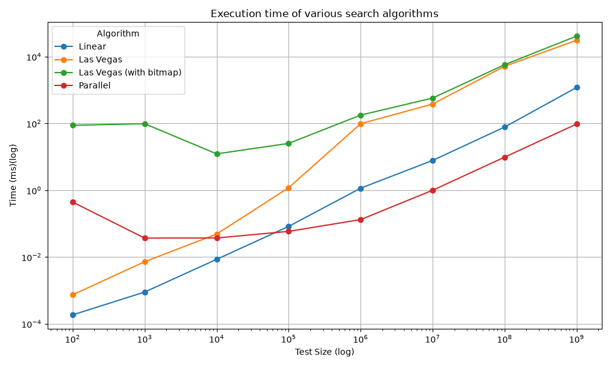

# Gambler

Benchmarks for 3 searching algorithms - Linear, Las Vegas (with a bitmap variant) and Parallel (GPU). Each algorithm runs a test size between 100 and 1 billion 32-bit unsigned integers at an increment of 10x. Every iteration gets 10 runs and the average of those runs is used to calculate the final execution time for that size.

## Build

Do not.

However if you still wish to do it:

### Requirements

```
C++ 23
AMD ROCm 7.2.4^
pandas
matplotlib 
numpy
```

Make sure `hipcc` works on your system and you can compile HIP kernels, this is necessary for `parallel_search`

 - After setting up the python virutal environment, run `python3 test_gen.py` to generate 1 billion 32 bit unsigned integer test cases.
 - Compile the benchmark
```
hipcc -std=c++23 test.cpp parallel_search.hip -o test
```
> Run `python3 run.py` to generate the benchmark results stored in `results.csv`
> Finally, to generate the plot, execute `python3 plot_gen.py`

## Results

 - The Las Vegas Search algorithm performed consistently worse compared to linear search
 - Las Vegas with a bitmap suffered further delays due to the added overhead of the bitmap
 - Parallel Search - executed on the GPU performed better under a bigger benchmark but suffered the second highest execution time at low test size incurred by host to device request latencies.

1z